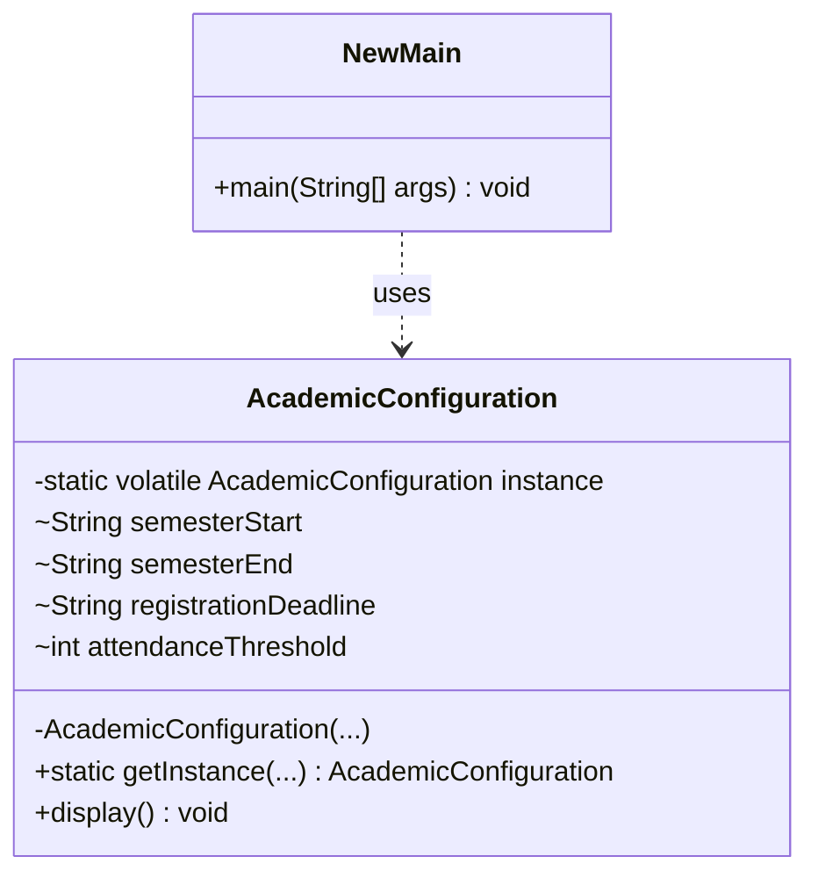
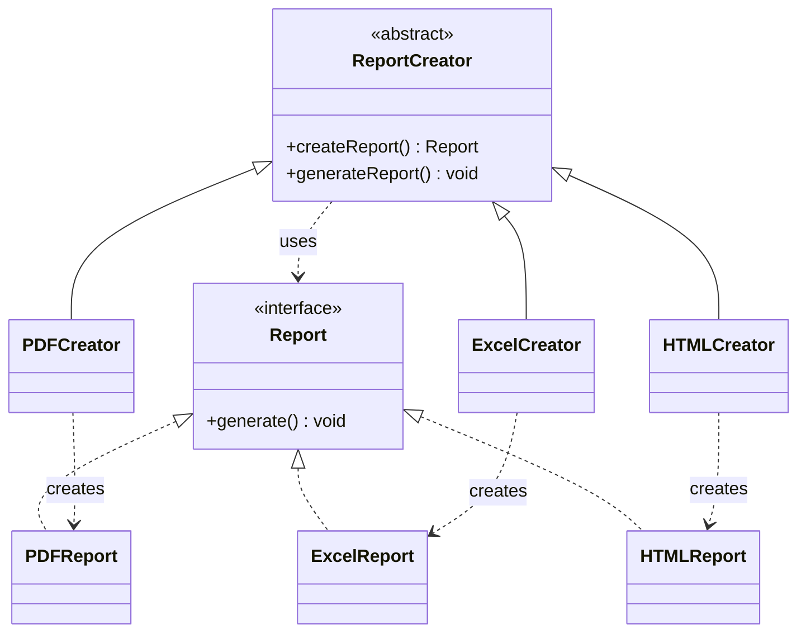
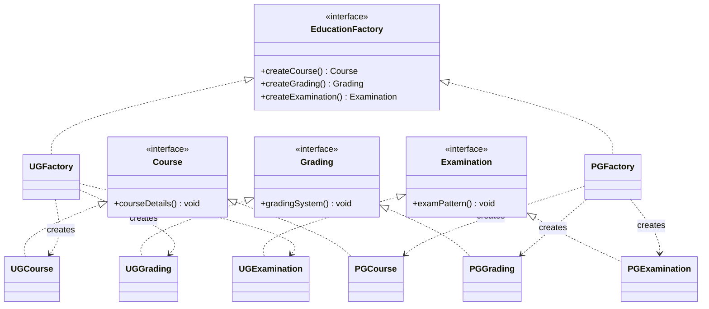

# Project-OOAD

## University Academic Management System

### Object-Oriented Analysis and Design (OOAD) | Semester V

A Java-based project demonstrating the practical implementation of three fundamental **Creational Design Patterns** — Singleton, Factory Method, and Abstract Factory — within a University Academic Management System.

The project focuses on applying object-oriented design principles to real-world academic workflows, improving code reusability, maintainability, consistency, and extensibility.

---

## 📌 Project Overview

Universities manage multiple academic operations, including student records, course information, examinations, grading policies, and report generation.

Without a structured software architecture, these operations may lead to duplicated logic, inconsistent configurations, and tightly coupled components.

This project demonstrates how design patterns can address these challenges through modular Java implementations.

### Objectives

- Understand the importance of design patterns in software engineering.
- Implement Singleton, Factory Method, and Abstract Factory patterns.
- Apply object-oriented concepts to university management.
- Improve modularity, scalability, and maintainability.
- Demonstrate pattern implementations using Java.

---

## 🛠️ Technology Stack

| Technology | Purpose |
|---|---|
| Java | Core implementation |
| Apache NetBeans | Development environment |
| Apache Ant | Project build configuration |
| UML | System and class modeling |
| OOP | Software design principles |
| Git & GitHub | Version control |

---

## 🧩 Design Patterns Implemented

| Design Pattern | Application | Purpose |
|---|---|---|
| Singleton | Academic Configuration | Maintain a single shared configuration |
| Factory Method | Report Generation | Create different report types |
| Abstract Factory | Academic Components | Create related UG and PG components |

---

## 1️⃣ Singleton Design Pattern

### Problem Statement

A university maintains academic configurations such as:

- Semester starting and ending dates
- Registration deadlines
- Attendance requirements

If multiple modules create separate configuration objects, the system may experience inconsistent information.

### Proposed Solution

The Singleton Design Pattern ensures that only one instance of the academic configuration exists throughout the application.

### Implementation

The `AcademicConfiguration` class maintains a shared instance using a private constructor and a static access method.

```java
AcademicConfiguration first =
    AcademicConfiguration.getInstance(
        "01-01-2026",
        "30-05-2026",
        "15-01-2026",
        75
    );

AcademicConfiguration second =
    AcademicConfiguration.getInstance(
        "01-06-2026",
        "30-11-2026",
        "15-06-2026",
        40
    );

System.out.println(first == second);
// Output: true
```

Both variables reference the same configuration instance. The first initialization determines the stored configuration.

### UML Class Diagram



### Advantages

- Ensures consistent academic configuration
- Prevents unnecessary object creation
- Provides centralized access
- Supports controlled initialization

### Limitations

- Introduces global shared state
- Can complicate unit testing
- Requires careful handling in multithreaded applications
- Configuration changes require additional design considerations

**Source Code:** [Singleton Implementation](5th_sem_OOAD_project/src/singleton/NewMain.java)

---

## 2️⃣ Factory Method Design Pattern

### Problem Statement

A university generates various types of academic reports, including:

- PDF reports
- Excel reports
- HTML reports

Directly creating every report object within the main application increases dependency on concrete implementations.

### Proposed Solution

The Factory Method Pattern delegates object creation to specialized creator classes.

The application interacts with the common `Report` interface rather than directly depending on specific report implementations.

### Implementation

```java
ReportCreator creator;

creator = new PDFCreator();
creator.generateReport();

creator = new ExcelCreator();
creator.generateReport();

creator = new HTMLCreator();
creator.generateReport();
```

### Expected Output

```text
Generating PDF Report...
Generating Excel Report...
Generating HTML Report...
```

The current implementation demonstrates report object creation and console messages, rather than generating actual report files.

### UML Class Diagram



### Advantages

- Reduces coupling between client code and concrete classes
- Supports the Open/Closed Principle
- Simplifies the addition of new report formats
- Promotes code reusability

### Limitations

- Requires additional creator classes
- Increases structural complexity for small applications
- May be unnecessary when only one object type exists

**Source Code:** [Factory Method Implementation](5th_sem_OOAD_project/src/factory_method/Main.java)

---

## 3️⃣ Abstract Factory Design Pattern

### Problem Statement

Universities offer undergraduate and postgraduate programs with different academic requirements.

These programs may differ in:

- Course offerings
- Grading systems
- Examination patterns

Creating these components independently may result in incompatible combinations.

### Proposed Solution

The Abstract Factory Pattern creates families of related academic components without requiring the client to depend on concrete classes.

Two concrete factories are implemented:

- `UGFactory` — Undergraduate academic components
- `PGFactory` — Postgraduate academic components

### Implementation

```java
EducationFactory factory = new UGFactory();

Course course = factory.createCourse();
Grading grading = factory.createGrading();
Examination exam = factory.createExamination();

course.courseDetails();
grading.gradingSystem();
exam.examPattern();
```

### Expected Output

```text
Undergraduate System:
UG Course: BCA, BSc, BCom
UG Grading: Semester-based CGPA
UG Examination: Written and Practical

Postgraduate System:
PG Course: MCA, MSc, MCom
PG Grading: CGPA and Research Evaluation
PG Examination: Written, Project and Viva
```

### UML Class Diagram



### Advantages

- Ensures consistency between related objects
- Separates object creation from business logic
- Makes switching between UG and PG configurations easier
- Encourages modular and maintainable design

### Limitations

- Introduces additional interfaces and classes
- Adding a new product category may require changing all factories
- Can be excessive for simple applications

**Source Code:** [Abstract Factory Implementation](5th_sem_OOAD_project/src/abstract_factory_method/Main.java)

---

## 📁 Project Structure

```text
OOAD-Project-/
│
├── README.md
│
└── 5th_sem_OOAD_project/
    │
    ├── src/
    │   │
    │   ├── singleton/
    │   │   ├── Main.java
    │   │   └── NewMain.java
    │   │
    │   ├── factory_method/
    │   │   └── Main.java
    │   │
    │   └── abstract_factory_method/
    │       └── Main.java
    │
    ├── nbproject/
    ├── build.xml
    └── manifest.mf
```

---

## 🚀 Getting Started

### Prerequisites

- Java Development Kit (JDK 8 or newer)
- Apache NetBeans IDE (optional)
- Git

### Step 1: Clone the Repository

```bash
git clone https://github.com/maariyahfaizan/OOAD-Project-.git
```

### Step 2: Navigate to the Project

```bash
cd OOAD-Project-/5th_sem_OOAD_project
```

### Step 3: Compile the Java Files

```bash
mkdir -p out

javac -d out \
  src/singleton/*.java \
  src/factory_method/*.java \
  src/abstract_factory_method/*.java
```

### Step 4: Run the Implementations

**Singleton:**

```bash
java -cp out singleton.NewMain
```

**Factory Method:**

```bash
java -cp out factory_method.Main
```

**Abstract Factory:**

```bash
java -cp out abstract_factory_method.Main
```

Alternatively, open the project folder directly in Apache NetBeans and run the required Java class.

---

## 📊 Comparison of Design Patterns

| Feature | Singleton | Factory Method | Abstract Factory |
|---|---|---|---|
| Main purpose | Control instance creation | Create an object through subclasses | Create related object families |
| Number of instances | One shared instance | Multiple possible instances | Multiple product families |
| Primary focus | Shared configuration | Flexible object creation | Related object consistency |
| University example | Academic settings | Report formats | UG/PG academic components |
| Complexity | Low | Moderate | Moderate to High |

---

## 💡 Real-World Applications

### Singleton
Centralized university settings, application configuration, and shared service instances.

### Factory Method
Generation of student reports, grade reports, attendance summaries, and other document formats.

### Abstract Factory
Creating related academic modules for undergraduate, postgraduate, and other educational programs.

---

## 🔮 Future Enhancements

The current application is a console-based demonstration of design patterns.

Potential improvements include:

- Student and faculty management
- Database integration
- Login and role-based authentication
- Attendance management
- Examination scheduling
- Real PDF, Excel, and HTML report exporting
- Graphical user interface
- Automated testing
- Student academic dashboards

---

## 📚 Learning Outcomes

Through this project, we explore:

1. The role of design patterns in object-oriented software development.
2. How Singleton controls object instantiation.
3. How Factory Method separates object creation from usage.
4. How Abstract Factory maintains consistency across related objects.
5. How UML diagrams represent software architecture.
6. The importance of maintainability, extensibility, and modularity.

---

## 🎓 Academic Information

**Project:** University Academic Management System

**Course:** Object-Oriented Analysis and Design (OOAD)

**Semester:** V

**Institution:** Aligarh Muslim University

**Implementation Language:** Java

---

## 📖 References

- Gamma, E., Helm, R., Johnson, R., & Vlissides, J. *Design Patterns: Elements of Reusable Object-Oriented Software.*
- [Refactoring Guru — Design Patterns](https://refactoring.guru/design-patterns)
- [Oracle Java Documentation](https://docs.oracle.com/en/java/)

---

## Conclusion

The University Academic Management System demonstrates how creational design patterns can address common software design challenges.

By implementing Singleton, Factory Method, and Abstract Factory, the project illustrates the importance of separating responsibilities, reducing coupling, and creating reusable software components.

The implementation provides a foundation for understanding how design patterns contribute to developing organized, maintainable, and extensible university management systems.
